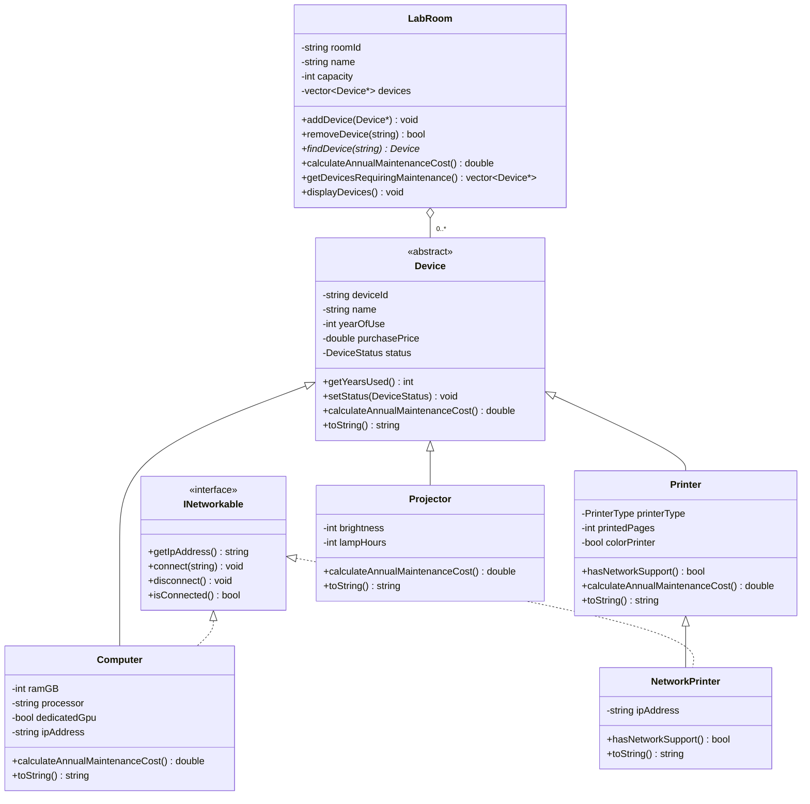

# lab-w05a
# Lab W05a - Quản lý thiết bị phòng thực hành

Chương trình C++ thực hành lớp trừu tượng, kế thừa, interface, đa hình và kết tập. Chương trình tạo sẵn dữ liệu và chạy các thao tác kiểm thử trên console.

## 1. Phạm vi

- Quản lý máy tính, máy in thường, máy in có mạng và máy chiếu.
- Quản lý danh sách thiết bị của phòng thực hành.
- Tính chi phí bảo trì dự kiến trong một năm.
- Lọc thiết bị cần bảo trì theo điều kiện của đề.
- Mô phỏng kết nối và ngắt kết nối qua `INetworkable`.

Đề minh họa một số khai báo bằng C#. Bản cài đặt này dùng C++17: interface được biểu diễn bằng lớp thuần ảo, property bằng getter, `List<Device>` bằng `std::vector<Device*>`, và kết quả tìm kiếm không tồn tại bằng `nullptr`.

Phần nội dung đề chưa có yêu cầu về thuộc tính, hành vi hay nghiệp vụ của hợp đồng bảo trì, vì vậy chương trình chưa xây dựng lớp hợp đồng. Đề cũng không yêu cầu menu nhập liệu, lưu file hoặc cơ sở dữ liệu.

## 2. Các file

Tất cả file đặt cùng một thư mục.

| File | Nội dung |
| --- | --- |
| `Device.h`, `Device.cpp` | Lớp trừu tượng và enum trạng thái thiết bị |
| `INetworkable.h` | Interface kết nối mạng |
| `Computer.h`, `Computer.cpp` | Máy tính và khả năng kết nối mạng |
| `Printer.h`, `Printer.cpp` | Máy in thông thường và enum loại máy in |
| `NetworkPrinter.h`, `NetworkPrinter.cpp` | Máy in có khả năng kết nối mạng |
| `Projector.h`, `Projector.cpp` | Máy chiếu |
| `LabRoom.h`, `LabRoom.cpp` | Phòng thực hành và danh sách thiết bị |
| `main.cpp` | Dữ liệu mẫu và kịch bản chạy |
| `.gitignore` | Bỏ qua file thực thi, file đối tượng và cấu hình cục bộ khi dùng Git |

## 3. Thiết kế

### Trách nhiệm của các lớp

| Lớp | Dữ liệu chính | Trách nhiệm |
| --- | --- | --- |
| `Device` | Mã, tên, năm sử dụng, giá mua, trạng thái | Kiểm tra dữ liệu chung, cung cấp thông tin và giao diện tính phí |
| `Computer` | RAM, CPU, GPU rời, IP | Tính phí máy tính, thực hiện thao tác mạng |
| `Printer` | Loại máy in, số trang, in màu | Tính phí máy in và cho biết có hỗ trợ mạng không |
| `NetworkPrinter` | IP | Bổ sung thao tác mạng, dùng lại công thức tính phí của `Printer` |
| `Projector` | Độ sáng, số giờ bóng đèn | Tính phí máy chiếu |
| `LabRoom` | Mã phòng, tên, sức chứa, danh sách con trỏ | Thêm, xóa, tìm, tổng hợp chi phí và lọc thiết bị |
| `INetworkable` | Không lưu dữ liệu | Quy định các thao tác mà một đối tượng có mạng phải cung cấp |

`Device` không thể được khởi tạo trực tiếp vì có phương thức thuần ảo `calculateAnnualMaintenanceCost()`. Mã thiết bị là thuộc tính `const` và không có setter; phép gán đối tượng làm thay đổi mã cũng bị chặn bởi C++.

Các thiết bị là những loại `Device`, còn `NetworkPrinter` là một loại `Printer`, nên kế thừa phù hợp với quan hệ is-a. `LabRoom` chứa thiết bị, không phải một loại thiết bị nên không kế thừa `Device`.

### Sơ đồ lớp rút gọn



Sơ đồ lược bớt constructor, getter và các thao tác mạng đã liệt kê trong interface. Số thiết bị thực tế trong phòng không vượt `capacity`.

### Ba phương án biểu diễn máy in có mạng

| Phương án | Ưu điểm | Nhược điểm | Khi phù hợp |
| --- | --- | --- | --- |
| Mọi `Printer` đều thực thi `INetworkable` | Ít lớp, dễ viết và kiểm thử | Chỉ chính xác khi mọi máy in đều có mạng; không biểu diễn được máy in thường trong mô hình này | Hệ thống chỉ mua máy in mạng |
| Thêm `NetworkPrinter : Printer, INetworkable` | Thể hiện năng lực ngay trong kiểu dữ liệu, tận dụng công thức của lớp cha | Thêm lớp, một phần thao tác mạng giống `Computer` | Bài lab có ít loại thiết bị và năng lực tương đối cố định |
| Tách thành phần kết nối mạng, gắn vào thiết bị cần dùng | Dùng lại xử lý mạng, linh hoạt khi thêm nhiều năng lực | Quản lý thêm thành phần và cách lấy interface, khó đọc hơn với bài nhỏ | Hệ thống lớn, nhiều tổ hợp tính năng |

Xét độ đơn giản và độ phức tạp triển khai, phương án thứ nhất nhẹ nhất nhưng thay đổi mô hình nghiệp vụ; phương án thứ hai giữ thiết kế gọn và vẫn phân biệt được hai loại máy in. Phương án thành phần có lợi hơn về tính linh hoạt, khả năng mở rộng và tái sử dụng khi xuất hiện nhiều năng lực mới. Về bảo trì và kiểm thử, lớp con dễ kiểm tra trong bài này, còn thành phần cho phép kiểm thử riêng xử lý mạng nhưng cần kiểm tra cả phần tích hợp. Chênh lệch hiệu năng ở quy mô bài lab không đáng kể; danh sách thiết bị và thuật toán duyệt mới là yếu tố chính.

**Trade-off của lựa chọn hiện tại (4 câu):** Chương trình tách `NetworkPrinter` kế thừa `Printer` và thực thi `INetworkable`, nên máy in thường không bị buộc phải cung cấp chức năng mạng. `NetworkPrinter` dùng lại dữ liệu và công thức bảo trì của `Printer`, do đó vẫn thay thế được lớp cha trong các thao tác quản lý thiết bị. Đổi lại, chương trình có thêm một lớp và phần xử lý kết nối ngắn bị lặp giữa máy tính với máy in mạng. Nếu có nhiều loại thiết bị có mạng hoặc nhiều khả năng kết hợp, việc tách thành phần mạng riêng sẽ thuận lợi hơn cho tái sử dụng và bảo trì.

### Kết tập và vòng đời

`LabRoom` lưu `std::vector<Device*>` không sở hữu thiết bị. `removeDevice()` chỉ xóa con trỏ khỏi danh sách; hủy phòng chỉ hủy vector, không gọi `delete` lên thiết bị. Đây là Aggregation (kết tập), vì thiết bị tồn tại độc lập với phòng.

Các thiết bị chính được tạo trước phòng trong `main()`, nên chúng còn tồn tại trong suốt thời gian phòng sử dụng chúng. Phòng `B202` nằm trong một khối lệnh riêng; sau khi khối kết thúc, chương trình vẫn in được máy in và máy chiếu của phòng đó. Khi mở rộng chương trình, bên quản lý thiết bị phải bảo đảm không hủy thiết bị khi phòng vẫn giữ con trỏ đến nó.

Không lưu bằng `vector<Device>`: `Device` là lớp trừu tượng, và lưu lớp dẫn xuất theo giá trị của lớp cơ sở cũng không giữ được đầy đủ phần dẫn xuất. Không dùng `unique_ptr<Device>` trong phòng, vì cách đó trao quyền sở hữu thiết bị cho phòng, không phù hợp với vòng đời đang chọn. Bản này chỉ kiểm tra trùng mã trong từng phòng theo đề, chưa có lớp quản lý toàn trường để ngăn một thiết bị được gán vào nhiều phòng.

### Đa hình và đóng gói

- Tổng chi phí gọi `device->calculateAnnualMaintenanceCost()` qua `Device*`. Không có nhánh phân loại máy tính, máy in, máy chiếu trong hàm tổng hợp.
- `toString()` là hàm ảo trong `Device` và được ghi đè ở lớp dẫn xuất để trả thông tin riêng.
- Danh sách `vector<INetworkable*>` chứa hai máy tính và một máy in mạng. Vòng lặp chỉ gọi phương thức của interface.
- `Printer::hasNetworkSupport()` trả `false`; `NetworkPrinter` ghi đè để trả `true`. Không lưu thêm cờ mạng dễ bị lệch với kiểu đối tượng.
- Destructor của `Device` và `INetworkable` là virtual.
- Các thuộc tính được đặt private. `LabRoom` chỉ trả tham chiếu const đến vector để bên ngoài không tự thêm/xóa con trỏ trong danh sách.

Các lớp bám theo trách nhiệm của bài lab, chưa cần tách thêm lớp tính phí cho từng công thức ngắn. `displayDevices()` còn trực tiếp xuất console; nếu phát triển giao diện khác, có thể chuyển phần hiển thị sang lớp giao diện mà giữ nguyên xử lý phòng.

## 4. Công thức và quy tắc

Gọi `P` là giá mua:

| Thiết bị | Chi phí một năm |
| --- | --- |
| Máy tính | `5% * P + (có GPU rời ? 2% * P : 0) + (trên 5 năm ? 1% * P : 0)` |
| Máy in | `4% * P + (trên 100000 trang ? 500000 : 0) + (in màu ? 300000 : 0)` |
| Máy chiếu | `3% * P + (trên 3000 giờ ? 1500000 : 0)` |

Thuộc tính `colorPrinter` được bổ sung vì đề có phụ phí in màu; loại laser/phun không xác định được một máy có in màu hay không.

- Năm hiện tại lấy từ đồng hồ hệ thống, không cố định 2026 trong code.
- Tất cả điều kiện “trên” dùng `>`, không dùng `>=`.
- Danh sách cần bảo trì chỉ dùng điều kiện `UnderMaintenance` **hoặc** số năm sử dụng `> 5`. Số trang và số giờ bóng đèn ảnh hưởng chi phí, không tự động bổ sung điều kiện lọc ngoài đề.
- Thiết bị `Retired` vẫn có thể xuất hiện trong danh sách nếu trên 5 năm; đề chưa có quy tắc loại trừ trạng thái này.
- Địa chỉ IP phải có ký tự khác khoảng trắng. Chương trình chỉ mô phỏng trạng thái kết nối, không thực hiện kết nối mạng thật và chưa kiểm tra đầy đủ cú pháp IPv4/IPv6.
- Kết nối lại khi đang kết nối bị từ chối. Ngắt kết nối xóa IP; `isConnected()` lấy kết quả từ việc IP có rỗng hay không, nên không cần thêm biến bool lưu trùng trạng thái.
- Bổ sung kiểm tra tên không rỗng, năm dương, RAM/độ sáng/sức chứa dương, số trang/số giờ không âm và không thêm thiết bị khi phòng đầy.
- Số tiền dùng `double` và hiển thị theo đồng. `double` không tương đương số thập phân chính xác như `decimal` của C#; nếu áp dụng cho kế toán thực tế cần quy ước làm tròn và kiểu tiền phù hợp.

## 5. Biên dịch và chạy

Cần trình biên dịch C++ hỗ trợ C++17, ví dụ GCC/MinGW. Mở terminal tại thư mục chứa `main.cpp`.

### Windows PowerShell

```powershell
g++ -std=c++17 -Wall -Wextra -Wpedantic main.cpp Device.cpp Computer.cpp Printer.cpp NetworkPrinter.cpp Projector.cpp LabRoom.cpp -o labw05a.exe
.\labw05a.exe
```

### Linux hoặc macOS có g++

```bash
g++ -std=c++17 -Wall -Wextra -Wpedantic main.cpp Device.cpp Computer.cpp Printer.cpp NetworkPrinter.cpp Projector.cpp LabRoom.cpp -o labw05a
./labw05a
```

Phải biên dịch các file `.cpp` cùng nhau. Biên dịch riêng `main.cpp` sẽ thiếu phần định nghĩa phương thức của các lớp khi liên kết.

## 6. Dữ liệu và kết quả mẫu

Năm sử dụng của dữ liệu mẫu được đặt tương đối so với năm hiện tại để các nhánh kiểm thử vẫn có ý nghĩa khi chạy vào năm khác.

| Phòng | Mã | Dữ liệu nổi bật | Chi phí (VND) |
| --- | --- | --- | ---: |
| A101 | C001 | Giá 20 triệu, không GPU rời, dùng 3 năm | 1.000.000 |
| A101 | C002 | Giá 30 triệu, GPU rời, dùng 6 năm | 2.400.000 |
| A101 | PR001 | Giá 5 triệu, 50.000 trang, đen trắng | 200.000 |
| B202 | PR002 | Giá 8 triệu, 120.001 trang, in màu, có mạng | 1.120.000 |
| B202 | PJ001 | Giá 15 triệu, 3.501 giờ bóng đèn | 1.950.000 |

- Tổng phòng A101: **3.600.000 VND**.
- Tổng phòng B202: **3.070.000 VND**.
- Thiết bị cần bảo trì của A101: `C002`, do sử dụng trên 5 năm.
- Thiết bị cần bảo trì của B202: `PJ001`, do trạng thái `UnderMaintenance`.
- `PR002` có phụ phí do số trang và in màu, nhưng không thuộc danh sách cần bảo trì theo bộ lọc mà đề quy định.

### Các tình huống thể hiện trong main

| Tình huống | Kết quả mong đợi |
| --- | --- |
| Thêm 5 thiết bị chính vào 2 phòng | Thêm thành công |
| Thêm đối tượng khác nhưng có cùng mã `C001` | Bị từ chối |
| In danh sách và tính chi phí | Hiển thị đúng từng loại và tổng mỗi phòng |
| Kết nối qua `INetworkable*` | Hai máy tính và máy in mạng có IP |
| Kết nối lần nữa khi chưa ngắt | Bị từ chối, IP cũ giữ nguyên |
| Ngắt kết nối | `false`, IP rỗng |
| Kết nối với IP rỗng | Bị từ chối |
| Thêm `nullptr` | Bị từ chối |
| Thêm thiết bị vào phòng đã đầy | Bị từ chối |
| Tìm mã có tồn tại / không tồn tại | Trả đúng con trỏ / `nullptr` |
| Xóa thiết bị có tồn tại / xóa lần hai | `true` / `false` |
| Dùng thiết bị sau khi xóa khỏi phòng | Thiết bị vẫn tồn tại |
| Dùng thiết bị sau khi hủy phòng B202 | Thiết bị vẫn tồn tại |

### Kiểm tra các mốc biên

| Dữ liệu | Mong đợi |
| --- | --- |
| Máy tính giá 20 triệu, không GPU, đúng 5 năm | 1.000.000 VND |
| Máy tính giá 20 triệu, không GPU, 6 năm | 1.200.000 VND |
| Máy in giá 5 triệu, đen trắng, đúng 100.000 trang | 200.000 VND |
| Máy in giá 5 triệu, đen trắng, 100.001 trang | 700.000 VND |
| Máy chiếu giá 15 triệu, đúng 3.000 giờ | 450.000 VND |
| Máy chiếu giá 15 triệu, 3.001 giờ | 1.950.000 VND |
| Phòng rỗng | Tổng 0, danh sách cần bảo trì rỗng |
| Mã rỗng, giá không dương, năm tương lai | Ném ngoại lệ `invalid_argument` |

## 7. Độ phức tạp

Với `n` thiết bị trong phòng:

- Tìm theo mã: `O(n)`.
- Thêm thiết bị: `O(n)` do phải kiểm tra trùng mã.
- Xóa thiết bị: `O(n)` do tìm và dịch phần tử trong vector.
- Tính tổng, hiển thị và lọc thiết bị: `O(n)`; bộ lọc cần thêm tối đa `O(n)` bộ nhớ cho kết quả.
- Tính phí của từng thiết bị: `O(1)`.

Vector phù hợp với danh sách nhỏ trong bài thực hành, dễ duyệt và dễ quản lý. Khi danh sách lớn và tìm kiếm theo mã thường xuyên, có thể bổ sung `unordered_map`; đổi lại phải quản lý thêm chỉ mục và giữ nó đồng bộ khi thêm/xóa.
